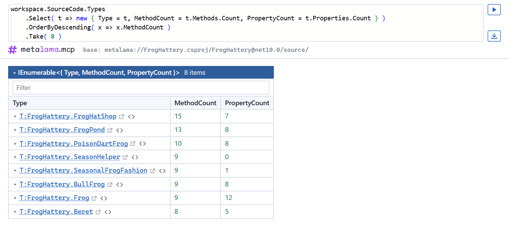
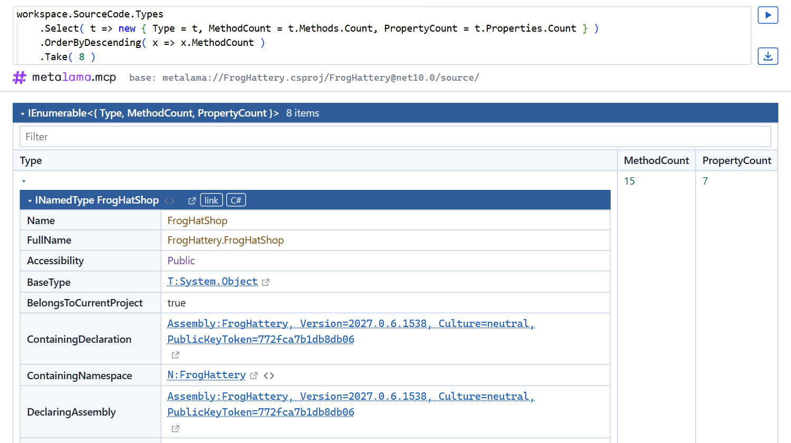
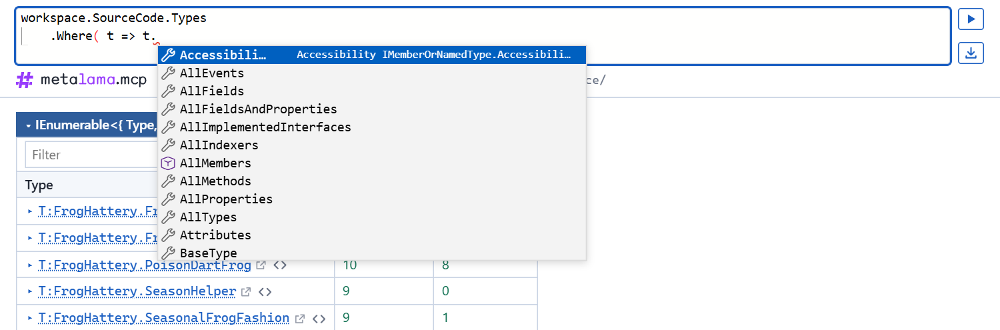
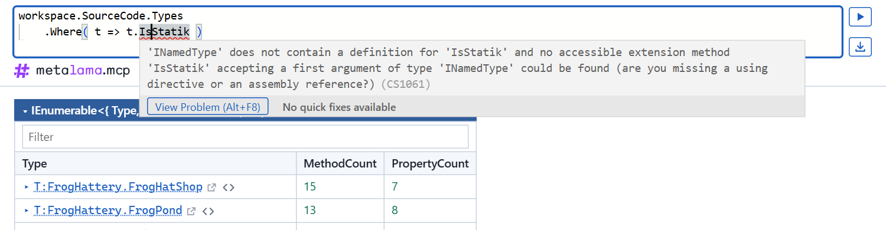

# Using the MCP server

The Metalama MCP server lets coding agents explore your source code the way you do with <xref:linqpad>. An agent loads a project or solution once, then runs C# queries over the same code model as aspects and fabrics: declarations, references, aspect instances, diagnostics, metrics, and the code transformed by Metalama.

The server loads and compiles the project itself, so its results describe the code, not the output of your last build. To ask what the real build did with the aspects, use the `metalama introspect` command instead. For a comparison, see <xref:introspection>.

The server implements the [Model Context Protocol](https://modelcontextprotocol.io) (MCP), so it works with any agent that supports MCP, such as Claude Code, GitHub Copilot or Cursor.

> [!NOTE]
> The `Metalama.Mcp` package is [open-source](https://github.com/metalama/Metalama/tree/HEAD/Metalama.Introspection/src/Metalama.Mcp).

## Installing the server

The server is the `metalama-mcp` .NET tool from the `Metalama.Mcp` package. It requires the .NET 10 SDK or later.

1. Install the tool:

    ```powershell
    dotnet tool install -g Metalama.Mcp
    ```

2. Register the `metalama-mcp` command with your agent. With Claude Code:

    ```powershell
    claude mcp add metalama -- metalama-mcp
    ```

    Other agents take the same command in their MCP configuration file. Start the agent from the directory of your repository, because the server resolves relative paths against its working directory.

3. To view results in your browser, trust the ASP.NET Core development certificate once, if you have not done it already for ASP.NET Core development:

    ```powershell
    dotnet dev-certs https --trust
    ```

The command accepts these options:

| Option | Description |
|--------|-------------|
| `--no-http` | Never start the HTTPS server that shows results in your browser. The server then opens no port at all. See [Viewing results in a browser](#viewing-results-in-a-browser). |
| `--timeout <seconds>` | The default soft timeout of a query, 60 seconds by default. See [Timeouts and limits](#timeouts-and-limits). |
| `--editor-link <template>` | The link with which an HTML page opens a source location, shown as an icon next to each declaration. `{path}` is the absolute path in URI form, such as `/C:/src/App.cs`, and `{line}` is the line. The default, `vscode://file{path}:{line}`, opens Visual Studio Code. Use `none` to show locations as text. |

> [!WARNING]
> The `Metalama.Mcp` version must be **equal to or higher than** the `Metalama.Framework` package version used in your projects.

## Security

The server runs arbitrary C# code by design, with the privileges of the user who started it. It is not a sandbox.

* **Only the agent and you can run code.** The agent sends queries through the standard input and output of the server. You can edit and run a query in a result page in your browser.
* **The browser view is private to the session.** To show results in your browser, the server listens on `localhost` only, on a random port, and only after the agent first shows a result in your browser. Its URLs contain a random secret: treat a link as a password, because any program that has it can run code in the session. Without the secret, other programs get nothing. The server also accepts a query only from its own pages, so a web page in your browser cannot run one, even if it learns a link. Use `--no-http` to disable it.
* **Loading a project runs its build logic.** Like a build, loading a workspace runs the MSBuild targets of the project and its Metalama aspects and fabrics. Only load code that you trust.
* **The analyzed code is data.** String literals and comments in the analyzed code can contain text aimed at the agent. This is the same risk as when the agent reads the files with its other tools.

## Telemetry

The server sends an anonymous usage report at most once a day for each workspace that it loads, and lets you review a report of an unexpected failure before it is sent. The reports never contain paths, names of your code, source code or query text. The server follows the telemetry settings of Metalama, so the same methods disable it. For the content of the reports and the opt-out methods, see <xref:telemetry>.

## Tools

The server exposes five tools to the agent.

| Tool | Description |
|------|-------------|
| `load_workspace` | Loads one or more projects, solutions or solution filters (`.csproj`, `.sln`, `.slnx`, `.slnf`) and keeps them loaded for the session. Returns the projects, their target frameworks, and the load diagnostics. |
| `reload_workspace` | Reloads a workspace from disk after its files were edited. |
| `unload_workspace` | Frees the memory used by a workspace. |
| `query` | Runs a C# query and renders its result. |
| `open` | Renders the object that a link names. See [Links](#links). |

Agents receive the instructions of the server when they connect, so they usually need no further explanation. You can ask an agent questions such as "which public methods of the domain layer have more than five parameters?" or "which aspects apply to `OrderService`?".

The result of `load_workspace` lists the projects of the workspace as _scopes_ of the form `Project@tfm`:

```text
workspace: FrogHattery.csproj (loaded in 4.3 s)
base: metalama://FrogHattery.csproj/FrogHattery@net10.0/source/
projects:
  FrogHattery@net10.0    workspace.GetProject("FrogHattery", "net10.0")  Metalama enabled
load diagnostics: 0 error(s), 0 warning(s)
fingerprint: b3d816ee695f50d6
```

## Writing queries

A query is either a C# expression, whose value is rendered, or a block of statements that ends with `return`. Queries have the same API as LINQPad queries. For details, see <xref:workspaces>.

The following globals are available:

| Global | Description |
|--------|-------------|
| `workspace` | The loaded <xref:Metalama.Framework.Workspaces.Workspace>. |
| `workspaces` | All loaded workspaces, by key. |
| `D(id)`, `D<T>(id)` | Resolves a declaration identifier, such as `T:MyApp.Customer`, in the source code. Pass `project` and `tfm` when the workspace has several projects or target frameworks, and `transformed: true` to resolve it in the transformed code. |
| `Open(link)`, `Open<T>(link)` | Resolves a link printed by a previous result. |
| `ct` | A cancellation token that is canceled on the soft timeout. |

The namespaces imported by LINQPad queries are imported, as well as `System`, `System.Collections.Generic`, `System.Linq`, `System.Text` and `System.Threading.Tasks`. A query can use `await`.

For instance, the following query lists the types that derive from `Frog`:

```csharp
workspace.SourceCode.Types.Where( t => t.BaseType?.Name == "Frog" )
```

The agent receives this result:

```text
base: metalama://FrogHattery.csproj/FrogHattery@net10.0/source/
IEnumerable<INamedType> — 3 items
T:FrogHattery.TreeFrog        TreeFrog.cs:6
T:FrogHattery.PoisonDartFrog  PoisonDartFrog.cs:6
T:FrogHattery.BullFrog        BullFrog.cs:6
--- 687 ms · fingerprint b3d816ee695f50d6 ---
```

Each declaration starts with its link and ends with its location, relative to the directory of the loaded project or solution, which the agent can open with its file tools.

A projection to an anonymous type is rendered as a table. A column that holds a declaration, rather than its name, keeps its link, so that the agent can open it and you can expand it in the browser:

```csharp
workspace.SourceCode.Types
    .OrderByDescending( t => t.Methods.Count )
    .Select( t => new { Type = t, Methods = t.Methods.Count } )
    .Take( 5 )
```

```text
IEnumerable<{ Type, Methods }> — 5 items
Type                          Methods
T:FrogHattery.FrogHatShop     15
T:FrogHattery.FrogPond        13
T:FrogHattery.PoisonDartFrog  10
T:FrogHattery.Frog            9
T:FrogHattery.SeasonHelper    9
```

The server shows the same properties as the LINQPad driver: properties marked with <xref:Metalama.Framework.Utilities.HiddenAttribute> or <xref:System.ObsoleteAttribute> are not displayed. A query can still read them.

When a query writes to the console, its output is returned in a `--- console ---` section. Diagnostics that the query reports are returned in an `--- error list ---` section.

## Links

Every rendered object starts with a _link_: a stable identifier that the agent passes to the `open` tool, or to `Open(…)` or `Open<T>(…)` in a query, to continue from that object. A link that is a declaration identifier, such as `T:MyApp.Customer`, can also be passed to `D(…)` or `D<T>(…)`; other links, such as `T:MyApp.Customer/Methods` or an absolute `metalama://` link, need `Open(…)`. The server keeps no table of links: it resolves each link again from its text.

A link consists of an _anchor_ followed by _steps_:

* The anchor is usually a declaration identifier, such as `T:FrogHattery.BullFrog`, as returned by <xref:Metalama.Framework.Code.IDeclaration.ToSerializableId*>. It can also be `project`, `projects`, `diagnostics`, `aspect-instances`, `aspect-classes`, `advice` or `transformations`.
* Each step is a property name, such as `Methods`, or a zero-based index.

For instance, `open` with the link `T:FrogHattery.BullFrog/Methods` returns:

```text
IEnumerable<IMethod> — 9 items
M:FrogHattery.BullFrog.CatchFly                         BullFrog.cs:24
M:FrogHattery.BullFrog.ChallengeFrog(FrogHattery.Frog)  BullFrog.cs:41
…
```

Links are relative to the _base_ printed at the top of each result. The absolute form is `metalama://<workspace>/<project>@<tfm>/<source|transformed>/<anchor>/<steps>`.

After the agent edits files and calls `reload_workspace`, links to declarations remain valid as long as the declarations exist. Links that contain an index carry a fingerprint, such as `?v=b3d816ee695f50d6`, and report `stale` after any reload, because the order of some collections of the code model can change between two loads.

## Viewing results in a browser

When you want to look at a result yourself, ask the agent to show it in your browser. The agent runs the query with the `html` format and gives you a link such as `https://localhost:53229/…/r/…`, which you open in your browser.

### Example: the types with the most methods

Ask the agent:

> List the eight types with the most methods, with their number of methods and properties, and show them in my browser.

The agent writes a query that selects the types themselves, not their names, so that each row of the result links to its declaration:

```csharp
workspace.SourceCode.Types
    .Select( t => new { Type = t, MethodCount = t.Methods.Count, PropertyCount = t.Properties.Count } )
    .OrderByDescending( x => x.MethodCount )
    .Take( 8 )
```

The page shows the query at the top and the result as a grid, as LINQPad does:



* Collections are grids with one column per property. Click a column header to sort the grid, and type in the **Filter** box to keep the rows that contain a text.
* Each declaration is followed by two icons. The first opens the declaration on a page of its own, in a new browser window. The second opens its source file at the line in your editor.

### Exploring a declaration

Click the arrow before a declaration, or the declaration itself, to expand its properties in place:



* Objects are property tables. Click the header of a table to collapse or expand it.
* Values that the page does not hold yet, such as the properties of a declaration several levels down, are loaded from the server when you click them, so you can browse as deep as you want.
* The **link** and **C#** buttons of a declaration copy its link, which the agent accepts, and the C# expression that resolves it in a query, such as `D<INamedType>("T:FrogHattery.FrogHatShop")`.

### Editing the query

The query is shown in an editor, with completion, tooltips, parameter hints and errors underlined as you type, as in Visual Studio Code. For instance, type `t.` in a lambda to list the members of a type:



Hover over an underlined error to read it:



Click the run button, or press Ctrl+Enter, to see the result of the edited query on its own page. Use the browser's Back button to return to the previous result. Errors that prevent the query from running appear under the editor.

The download button, under the run button, saves a snapshot of the page. The snapshot works without the server, but only expands what it holds.

### More examples

The following requests also produce pages that are worth exploring in the browser:

* "Show me in my browser the public methods that have more than five parameters."
* "Which types derive from `Entity`? Show them in my browser with the files they are in."
* "Show me in my browser the aspect instances of the solution, grouped by aspect class."
* "Open `T:MyApp.OrderService` in my browser."

### How the page works

The link works while the agent's session runs. The page contacts only the server of that session, on `localhost`, to load the values you open and to run the queries you edit. The agent does not see the queries you run in the page.

If the agent reports that the development certificate is missing, run `dotnet dev-certs https --trust`.

### In the conversation

Agents that support MCP Apps, such as Claude, also show results as a view in the conversation, without being asked. Where the agent lets the view call the server, clicking a value opens it in place. Otherwise, the values of the view cannot be opened, and once a result was shown in your browser in the session, the view has an **Open in browser** button that opens the same result there.

### For other programs

The `json` format returns the same tree as JSON, for agents that process results further. Its schema is `result.schema.json` in the `Metalama.Mcp` package.

## Timeouts and limits

* A query is canceled through `ct` after its soft timeout, 60 seconds by default. A query that does not observe `ct` is stopped after twice that time: the server restarts its worker process and reloads the workspaces on the next call.
* A result for the agent shows 50 items per collection and one level of properties by default. The agent can change these limits with the `maxItems` and `maxDepth` arguments. A page in your browser holds at least 500 items and three levels, and loads the rest when you open it.
* A text result is limited to 20,000 characters.

## See also

> [!div class="see-also"]
> <xref:linqpad>
> <xref:workspaces>
> <xref:Metalama.Framework.Workspaces>
> <xref:Metalama.Framework.Introspection>
