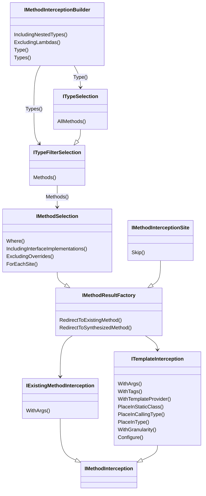

This namespace allows you to intercept the calls to methods of any assembly, and to redirect them to an existing method or to a method generated from a T# template.

## Conceptual documentation

Refer to <xref:intercepting-calls>.

## Overview

Aspects and fabrics register interceptors with the `InterceptMethods` extension methods of <xref:Metalama.Extensions.Interceptors.InterceptionAdviserExtensions> and <xref:Metalama.Extensions.Interceptors.InterceptionQueryExtensions>. The argument is a delegate that describes the interception as a chain of immutable values, in this order:

1. <xref:Metalama.Extensions.Interceptors.IMethodInterceptionBuilder> sets the calling code, and selects the type that declares the intercepted methods.
2. <xref:Metalama.Extensions.Interceptors.ITypeSelection> and <xref:Metalama.Extensions.Interceptors.ITypeFilterSelection> select the methods.
3. <xref:Metalama.Extensions.Interceptors.IMethodSelection> filters the methods, and chooses the interceptor through <xref:Metalama.Extensions.Interceptors.IMethodResultFactory>, or decides for each call site with <xref:Metalama.Extensions.Interceptors.IMethodSelection.ForEachSite*>.
4. <xref:Metalama.Extensions.Interceptors.IExistingMethodInterception> or <xref:Metalama.Extensions.Interceptors.ITemplateInterception> sets the options of the interceptor.

A template reads the description of the interception through the `meta.Interception` property, of type <xref:Metalama.Extensions.Interceptors.IInterceptionInfo>.

The <xref:Metalama.Extensions.Interceptors.ExcludeInterceptorsAttribute> attribute and the <xref:Metalama.Extensions.Interceptors.InterceptorConfigurationExtensions> extension methods exclude code from interception.

## Class diagram

